# RxDB realtime Sync Engine for Local-First Apps

> Replicate data in real-time with RxDB's offline-first Sync Engine. Learn about efficient syncing, conflict resolution, and advanced multi-tab support.

import { IconGear } from '@site/src/components/icons/gear';
import { HeadlineWithIcon } from '@site/src/components/headline-with-icon';
import {DocsAnimation} from '@site/src/components/docs-animation';
import {ReplicationPushPull} from '@site/src/components/animations/replication-push-pull';

# RxDB's realtime Sync Engine for Local-First Apps

The RxDB Sync Engine provides the ability to sync the database state in **realtime** between the clients and the server.

The backend server does not have to be an RxDB instance; you can build a replication with **any infrastructure**.
For example you can replicate with a [custom GraphQL endpoint](./replication-graphql.md) or an [HTTP server](./replication-http.md) on top of a PostgreSQL or MongoDB database.

The replication is made to support the [Local-First](./articles/local-first-future.md) paradigm, so that when the client goes [offline](./offline-first.md), the RxDB [database](./rx-database.md) can still read and write [locally](./articles/local-database.md) and will continue the replication when the client goes online again.

This page explains how the Sync Engine works. The options to start a replication are documented on the [replicateRxCollection()](./replicate-rx-collection.md) page, and the methods and observables of a running replication are on the [RxReplicationState](./rx-replication-state.md) page.

## Design Decisions of the Sync Engine

In contrast to other (server-side) database replication protocols, the RxDB Sync Engine was designed with these goals in mind:

- **Easy to Understand**: The sync engine works in a simple "git-like" way that is easy to understand for an average developer. You only have to understand how three simple endpoints work.
- **Complex Parts are in RxDB, not in the Backend**: The complex parts of the Sync Engine, like [conflict handling](./transactions-conflicts-revisions.md#replication-conflicts) or offline-online switches, are implemented inside of RxDB itself. This makes creating a compatible backend very easy.
- **Compatible with any Backend**: Because the complex parts are in RxDB, the backend can be "dumb" which makes the protocol compatible to almost every backend. No matter if you use PostgreSQL, MongoDB or anything else.
- **Performance is optimized for Client Devices and Browsers**: By grouping updates and fetches into batches, it is faster to transfer and easier to compress. Client devices and browsers can also process this data faster, for example running `JSON.parse()` on a chunk of data is faster than calling it once per row. Same goes for how client side storage like [IndexedDB](./rx-storage-indexeddb.md) or [OPFS](./rx-storage-opfs.md) works where writing data in bulks is faster.
- **Offline-First Support**: By incorporating conflict handling at the client side, the protocol fully supports [offline-first apps](./offline-first.md). Users can continue making changes while offline, and those updates will sync seamlessly once a connection is reestablished - all without risking data loss or having undefined behavior.
- **Multi-Tab Support**: When RxDB is used in a browser and multiple tabs of the same application are opened, only exactly one runs the replication at any given time. This reduces client- and backend resources.

## The Sync Engine on the document level

On the [RxDocument](./rx-document.md) level, the replication works like git, where the fork/client contains all new writes and must be merged with the master/server before it can push its new state to the master/server.



- The client pulls the latest state `B` from the master.
- The client does some changes `C+D`.
- The client pushes these changes to the master by sending the latest known master state `B` and the new client state `D` of the document.
- If the master state is equal to the latest master `B` state of the client, the new client state `D` is set as the latest master state.
- If the master also had changes and so the latest master change is different than the one that the client assumes, we have a conflict that has to be resolved on the client.

## The Sync Engine on the transfer level

When document states are transferred, all handlers use batches of documents for better performance.
The server **must** implement the following methods to be compatible with the replication:

- **pullHandler** Get the last checkpoint (or null) as input. Returns all documents that have been written **after** the given checkpoint. Also returns the checkpoint of the latest written returned document.
- **pushHandler** a method that can be called by the client to send client-side writes to the master. It gets an array with the `assumedMasterState` and the `newForkState` of each document write as input. It must return an array that contains the master document states of all conflicts. If there are no conflicts, it must return an empty array.
- **pullStream** an observable that emits batches of all master writes and the latest checkpoint of the write batches.

  

The replication runs in two **different modes**:

### Checkpoint iteration

On first initial replication, or when the client comes online again, a checkpoint based iteration is used to catch up with the server state.
A checkpoint is a subset of the fields of the last pulled document. When the checkpoint is sent to the backend via `pullHandler()`, the backend must be able to respond with all documents that have been written **after** the given checkpoint.
For example if your documents contain an `id` and an `updatedAt` field, these two can be used as checkpoint.

When the checkpoint iteration reaches the last checkpoint, where the backend returns an empty array because there are no newer documents, the replication will automatically switch to the `event observation` mode.

### Event observation

While the client is connected to the backend, the events from the backend are observed via `pullStream$` and persisted to the client.

If your backend for any reason is not able to provide a full `pullStream$` that contains all events and the checkpoint, you can instead only emit `RESYNC` events that tell RxDB that anything unknown has changed on the server and it should run the pull replication via [checkpoint iteration](#checkpoint-iteration).

When the client goes offline and online again, it might happen that the `pullStream$` has missed out some events. Therefore the `pullStream$` should also emit a `RESYNC` event each time the client reconnects, so that the client can become in sync with the backend via the [checkpoint iteration](#checkpoint-iteration) mode.

## Data layout on the server

To use the replication you first have to ensure that:
- **documents are deterministically sortable by their last write time**

  *deterministic* means that even if two documents have the same *last write time*, they have a predictable sort order.
    This is most often ensured by using the *primaryKey* as second sort parameter as part of the checkpoint.

- **documents are never deleted, instead the `_deleted` field is set to `true`.**

  This is needed so that the deletion state of a document exists in the database and can be replicated to other instances. If your backend uses a different field to mark deleted documents, you have to transform the data in the push/pull handlers or with the modifiers.

For example if your documents look like this:

```ts
const docData = {
    "id": "todo1",
    "name": "Learn RxDB",
    "done": false,
    /**
     * Contains the last write timestamp
     * so all document writes can be sorted by that value
     * when they are fetched from the remote instance.
     */
    "updatedAt": 1564483474,
    /**
     * Instead of physically deleting documents,
     * a deleted document gets replicated.
     */
    "_deleted": false
}
```

Then your data is always sortable by `updatedAt`. This ensures that when RxDB fetches 'new' changes via `pullHandler()`, it can send the latest `updatedAt+id` checkpoint to the remote endpoint and then receive all newer documents.

By default, the field is `_deleted`. If your remote endpoint uses a different field to mark deleted documents, you can set the [`deletedField`](./replicate-rx-collection.md#options) in the replication options which will automatically map the field on all pull and push requests.

## Conflict handling

When multiple clients (or the server) modify the same document at the same time (or when they are offline), it can happen that a conflict arises during the replication. The master then rejects the write of the client and sends back its actual document state.

**RxDB resolves all conflicts on the client.** It calls the conflict handler of the [RxCollection](./rx-collection.md) and writes the resolved document state to the master again. By default the master state wins, so that clients that were offline for a long time do not overwrite the changes of other people.

How replication conflicts appear, how the default conflict handler works, and how to write a custom one is explained in [replication conflicts](./transactions-conflicts-revisions.md#replication-conflicts).

## Start a Replication

You start the replication of a single `RxCollection` with `replicateRxCollection()`. In the following minimal example the backend has one endpoint for pulling and one for pushing:

```ts
import { replicateRxCollection } from 'rxdb/plugins/replication';

const replicationState = replicateRxCollection({
    collection: myDatabase.todos,
    replicationIdentifier: 'todos-sync-https://example.com/api/sync',
    pull: {
        async handler(lastCheckpoint, batchSize) {
            const minUpdatedAt = lastCheckpoint ? lastCheckpoint.updatedAt : 0;
            const url = 'https://example.com/api/sync/pull'
                + '?minUpdatedAt=' + minUpdatedAt
                + '&limit=' + batchSize;
            const response = await fetch(url);
            // must return { documents, checkpoint }
            return await response.json();
        }
    },
    push: {
        async handler(rows) {
            const response = await fetch('https://example.com/api/sync/push', {
                method: 'POST',
                headers: { 'Content-Type': 'application/json' },
                body: JSON.stringify(rows)
            });
            // must return the master states of all conflicts, or []
            return await response.json();
        }
    }
});
```

All options like `live`, `retryTime`, `deletedField`, batch sizes, modifiers and the realtime `pull.stream$` are documented on the [replicateRxCollection()](./replicate-rx-collection.md) page.
The returned [RxReplicationState](./rx-replication-state.md) lets you observe errors, await the initial sync and cancel or pause the replication.

Instead of writing the handlers yourself, you can also use one of the replication plugins that already implement them, like the [HTTP replication](./replication-http.md), the [GraphQL replication](./replication-graphql.md), or the [WebSocket replication](./replication-websocket.md).

## Multi Tab support

For better performance, the replication runs only in one instance when RxDB is used in multiple browser tabs or Node.js processes.
By setting `waitForLeadership: false` you can enforce that each tab runs its own replication cycles.
If used in a multi instance setting, so when at database creation `multiInstance: false` was not set,
you need to import the [leader election plugin](./leader-election.md) so that RxDB can know how many instances exist and which browser tab should run the replication.

## Security

Be aware that client side clocks can never be trusted. When you have a client-backend replication, the backend should overwrite the `updatedAt` timestamp or use another field, when it receives the change from the client.

## Partial Sync with RxDB

RxDB supports partial sync patterns where you dynamically manage multiple replication states for different data scopes. This keeps local storage lean and reduces network overhead. Learn more on the dedicated [Partial Sync](./partial-sync.md) page.
